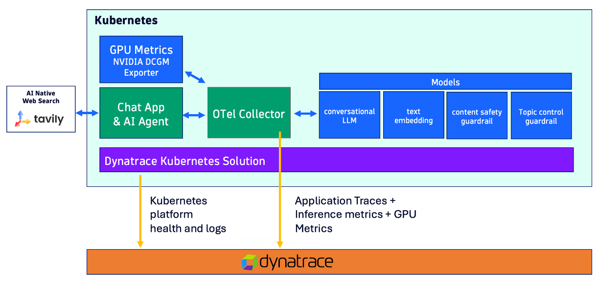

# NAT Chat App

This chat app demonstrates NVIDIA NeMo Guardrails with NIM model endpoints. The app supports input safety rails (jailbreak detection, blocked terms, input length, politics filtering) and exports traces via OpenTelemetry.

The chat app was built using:
* [NVIDIA NeMo Agent Toolkit](https://docs.nvidia.com/nemo/agent-toolkit/) and 
* NVIDIA [NeMo Guardrails](https://github.com/NVIDIA/NeMo-Guardrails). 
* [streamlit](https://www.streamlit.io) open-source app framework

All of the observability telemetry of traces, logs, and metrics are collected using the [Dynatrace distribution of the OpenTelemetry Collector](https://docs.dynatrace.com/docs/ingest-from/opentelemetry/collector) for analysis within [Dynatrace](https://www.dynatrace.com).

This diagram below depicts the setup consisting of:
* Chat app - Used to generate prompts and send telemetry data to and OpenTelemetry Collector
* OpenTelemetry Collector - Configured to send telemetry data to Dynatrace OTLP APIs
* LLM models - NVIDIA cloud APIs or NIM services hosted in your Kubernetes cluster
* Tavily - Uses as Agentic tool to search the internet and accessed via APIs and a Build API key
* Dynatrace - Observability and analysis



## Prerequisites

- Tavily API key (used for web search)
- NVIDIA API key from [build.nvidia.com](https://build.nvidia.com) (only for the `cloud` profile)
- Dynatrace environment and API token for OTLP ingest (for traces, logs and metrics)

## Models Used

| Role | `cloud` profile (NVIDIA cloud APIs) | `k8s` profile (NIM services in the cluster) |
|---|---|---|
| Main LLM: NAT agent workflow and the `check_politics` guardrail | `google/gemma-4-31b-it` | `nvidia/llama-3.1-nemotron-70b-instruct` |
| Content safety: input and output rails | `nvidia/nemotron-3.5-content-safety` | `nvidia/llama-3.1-nemoguard-8b-content-safety` |
| Topic control: input rail | `nvidia/nemotron-3.5-content-safety` (no topic-control model on the cloud API) | `nvidia/llama-3.1-nemoguard-8b-topic-control` |
| Embeddings: configured, not yet used by the workflow | `nvidia/nv-embedqa-e5-v5` | `nvidia/nv-embedqa-e5-v5` |

# Running the App

Both paths read their settings from `.env` in this directory. Copy [.env.template](.env.template) to `.env` and uncomment the LOCAL or CLOUD section.

Choose a path based on where the app runs and where the models are:

| App runs on | Models | Profile (`CONFIG_TYPE`) | Guide |
|---|---|---|---|
| Your machine (Python or Docker) | NVIDIA cloud APIs | `cloud` | [deploy/local](deploy/local/README.md) |
| Kubernetes cluster | NIM services in the same cluster | `k8s` | [deploy/k8s](deploy/k8s/README.md) |

See [PROMPTS.md](PROMPTS.md) for example prompts to explore how the guardrails behave.

## How the profile is applied

At startup, `CONFIG_TYPE` selects which template is copied to the active `config.yml` in both config folders:

| Template | Copied to |
|---|---|
| `guardrails_config/config.yml.<profile>` | `guardrails_config/config.yml` |
| `src/nat_simple_web_query/configs/config.yml.<profile>` | `src/nat_simple_web_query/configs/config.yml` |

* **Docker and Kubernetes:** `docker-entrypoint.sh` runs `python update_config.py "$CONFIG_TYPE"` automatically. The default is `cloud`.
* **Python:** run `python update_config.py cloud` yourself before `streamlit run app.py`.

Edit the `.cloud` or `.k8s` templates, not `config.yml`, which is generated and git-ignored.

# Building and pushing the image

The Docker option in [deploy/local](deploy/local/README.md) and the [deploy/k8s](deploy/k8s/README.md) path both use the same image. The `config.yml.cloud` and `config.yml.k8s` templates are copied into the image at build time, so rebuild and push a new version after you edit them.

The published image is `docker.io/dtdemos/nat-chat-app`. The version used by Kubernetes is set in `image:` in [deploy/k8s/app.yaml](deploy/k8s/app.yaml).

Run from this directory (`sample-apps/nat-chat-app`):

```bash
export IMAGE=docker.io/dtdemos/nat-chat-app:0.1

docker login docker.io -u <dockerhub-user>     # password: a Docker Hub access token
docker build --platform linux/amd64 -t $IMAGE .
docker push $IMAGE
```

* **Platform:** the cluster nodes are `amd64`. Keep `--platform linux/amd64` when you build on an Apple Silicon Mac, or the pods fail with `exec format error`. Check the result with `docker image inspect $IMAGE --format '{{.Architecture}}'`.
* **Podman:** the commands above work with Podman. Docker Desktop's buildx can do the build and push in one step: `docker buildx build --platform linux/amd64 -t $IMAGE --push .`
* **Versioning:** use a new tag for each release (`0.2`, `0.3` and so on) instead of `latest`. The Kubernetes manifest uses `imagePullPolicy: IfNotPresent`, so a node that already has a tag won't pull it again.

To run the image locally without pushing it, build it with any tag and use that tag in the `docker run` commands in [deploy/local](deploy/local/README.md).
